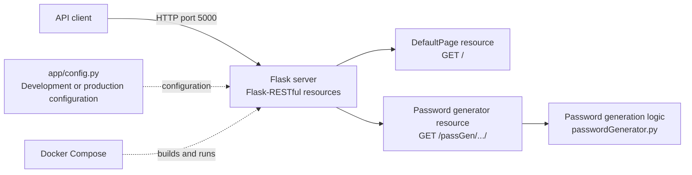

## 🚀 About Me

I'm a junior DevOps engineer with some expertise in BackEnd development using Java and Node.js; scripting skills with Python, Bash and JavaScript; besides CI/CD and cloud knowledge of AWS and Azure DevOps tools ...

<p align="center">

</p>


## 🔗 Portfolio

[](https://github.com/RecursiveDeveloper)
[](https://www.linkedin.com/in/jhoan-jesus-ortiz-sandoval-a66152198/)

# Python SecurityChecker API

A Flask-based JSON API lab for generating configurable passwords. Flask-RESTful provides the API resources, Flask-Cors enables cross-origin requests, and Docker Compose supplies a single-container local environment on port `5000`.

## Project Architecture



The application is self-contained: it has no database or external service dependency. The root resource returns a welcome message, while the password resource delegates generation to the `passgen` class and returns the result as JSON.

## Project Structure

```text
python_securitychecker_api-lab/
├── app/
│   ├── apis/
│   │   ├── passwordGenerator/
│   │   │   ├── __init__.py              # Password API resource export
│   │   │   ├── passwordGenerator.py     # Password generation implementation
│   │   │   └── passwordGeneratorAPI.py  # Flask-RESTful resource and input checks
│   │   ├── __init__.py
│   │   └── defaultPage.py               # Root welcome resource
│   ├── config.py                        # Development and production settings
│   ├── requirements.txt                 # Pinned Python dependencies
│   └── server.py                        # Application setup, routes, and entry point
├── .dockerignore                        # Files excluded from the image build context
├── .gitattributes
├── .gitignore
├── docker-compose.yaml                  # Flask service, port mapping, and network
├── dockerfile                           # Python 3.12 application image
└── README.md
```

## API Endpoints

| Method | Path | Description |
|---|---|---|
| `GET` | `/` | Returns the API welcome message. |
| `GET` | `/passGen/<passlength>/<capitalLetter>/<lowCaseLetter>/<specialCharacters>/` | Generates a password from the supplied length and character options. |

### Root Endpoint

```sh
curl http://localhost:5000/
```

Example response:

```json
{
  "Welcome to Python Security Checker API": "Feel free to use this open source API"
}
```

### Password Generation

All inputs are **path parameters**, not query parameters. Keep the trailing slash shown in the registered route.

```sh
curl http://localhost:5000/passGen/16/1/1/1/
```

| Parameter | Accepted values | Purpose |
|---|---|---|
| `passlength` | Integer | Requested password length. Values below `30` enter the generator; values of `30` or greater return the maximum-length message. |
| `capitalLetter` | `0` or `1` | Disable or enable uppercase letters in the candidate character pool. |
| `lowCaseLetter` | `0` or `1` | Disable or enable lowercase letters in the candidate character pool. |
| `specialCharacters` | `0` or `1` | Disable or enable special characters in the candidate character pool. |

Digits remain available regardless of the three option flags. Enabling a category makes its characters eligible but does not guarantee that the generated password contains at least one character from that category.

A successful response has the following shape:

```json
{
  "password": "<generated-password>"
}
```

The current implementation also returns application-level failures with its default HTTP `200` status:

- If any option flag is not `0` or `1`, `GeneratedPassword` is `"Error"`.
- If `passlength` is `30` or greater, `GeneratedPassword` contains `"You have overpassed the maximum length, the maximum length is 29 characters"`.
- Values that do not match Flask's integer path converters do not reach the resource and receive Flask's normal routing response.

## Prerequisites

For the Docker Compose workflow, install:

1. [Docker Engine or Docker Desktop](https://docs.docker.com/get-docker/).
2. Docker Compose v2, included with current Docker Desktop and Docker Engine installations. Verify it with:
   ```sh
   docker compose version
   ```
3. Git to clone the repository.

Python and pip are not required on the host for the Docker workflow. For local development without Docker, use Python 3.12 and pip instead.

## Usage

### Local Deployment with Docker Compose

1. **Clone the repository and enter its directory:**
   ```sh
   git clone https://github.com/RecursiveDeveloper/python_securitychecker_api-lab.git
   cd python_securitychecker_api-lab
   ```

2. **Build and start the Flask service from the repository root:**
   ```sh
   docker compose --progress auto up --build -d
   ```

   Compose builds the image as `flaskapp:v0.1`, creates a container named `flaskapp`, and maps host port `5000` to container port `5000`. No environment file is required.

3. **Check service status and application logs:**
   ```sh
   docker compose logs -f flaskapp
   ```

4. **Verify the API:**
   ```sh
   curl http://localhost:5000/
   curl http://localhost:5000/passGen/16/1/1/1/
   ```

### Local Deployment without Docker

1. **From the repository root, create and activate a virtual environment:**
   ```sh
   python3 -m venv .venv
   source .venv/bin/activate
   ```

   On Windows, activate the environment with `.venv\Scripts\activate` instead.

2. **Install the application dependencies:**
   ```sh
   python -m pip install -r app/requirements.txt
   ```

3. **Start the Flask development server:**
   ```sh
   python app/server.py
   ```

   The API listens on `http://localhost:5000`. Leave this process running while using the API.

4. **Verify the API from another terminal:**
   ```sh
   curl http://localhost:5000/
   curl http://localhost:5000/passGen/16/1/1/1/
   ```

5. **Stop the server and deactivate the virtual environment:**

   Press `Ctrl+C` in the terminal running Flask, then run:
   ```sh
   deactivate
   ```

### Configuration

`app/server.py` selects `DevelopmentConfig` by default. Setting the `PRODUCTION` environment variable to a non-empty value selects `ProductionConfig`:

```sh
PRODUCTION=1 python app/server.py
```

Both configuration classes currently define only Flask's `DEBUG` setting. The entry point explicitly calls `app.run(..., debug=False)`, so the built-in server does not enable its debugger in either mode.

### Stopping Services

Stop and remove the Compose container, network, images, and volumes:

```sh
docker compose down --rmi all --volumes
```

This also removes the locally built `flaskapp:v0.1` image and any volumes associated with the Compose project.

## Application Components

| Component | Responsibility |
|---|---|
| [`app/server.py`](app/server.py) | Creates Flask and Flask-RESTful instances, enables CORS, selects configuration, registers resources, and listens on port `5000`. |
| [`app/config.py`](app/config.py) | Defines development and production configuration classes. |
| [`app/apis/defaultPage.py`](app/apis/defaultPage.py) | Implements the root welcome resource. |
| [`app/apis/passwordGenerator/passwordGeneratorAPI.py`](app/apis/passwordGenerator/passwordGeneratorAPI.py) | Receives path values, validates option flags, invokes the generator, and creates the JSON response. |
| [`app/apis/passwordGenerator/passwordGenerator.py`](app/apis/passwordGenerator/passwordGenerator.py) | Builds the allowed character pool and generates the password string. |
| [`app/requirements.txt`](app/requirements.txt) | Pins the Python runtime dependencies. |
| [`dockerfile`](dockerfile) | Builds the `python:3.12.16-slim` application image and starts `server.py`. |
| [`docker-compose.yaml`](docker-compose.yaml) | Defines the `flaskapp` service, `5000:5000` port mapping, restart policy, and `flask-network` bridge network. |

## Requirements

### Container Runtime

| Component | Version or image |
|---|---|
| Python | `python:3.12.16-slim` |
| Docker Compose | v2 |
| Application port | `5000` |

### Application Dependencies

Versions below come from [`app/requirements.txt`](app/requirements.txt).

| Dependency | Version |
|---|---|
| Flask | `2.3.3` |
| Flask-Cors | `6.0.5` |
| Flask-RESTful | `0.3.10` |
| Werkzeug | `2.3.8` |
| gunicorn | `27.0.1` |
| itsdangerous | `2.2.0` |
| click | `8.1.8` |
| python-decouple | `3.8` |

## Authors

- [@RecursiveDeveloper](https://github.com/RecursiveDeveloper)

## License

[MIT](https://choosealicense.com/licenses/mit/)
